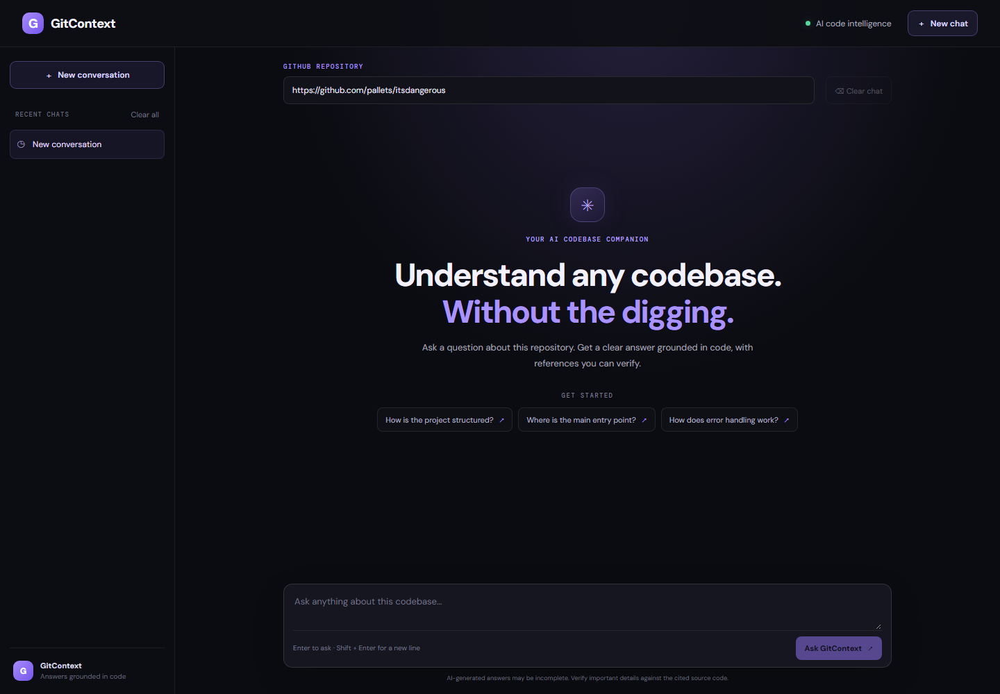
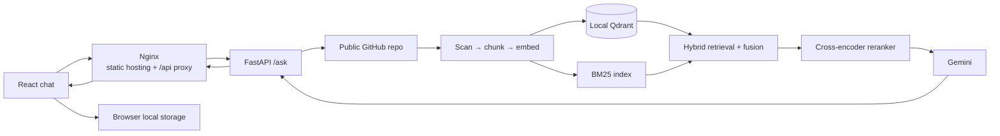

# GitContext

Ask questions about a public GitHub repository and get conversational
answers grounded in its source code.



[Architecture](docs/architecture.md) · [Demo](docs/demo.md) ·
[Resume description](docs/resume-project-description.md)

## What it does

GitContext ingests a repository, retrieves relevant code with semantic and
keyword search, reranks the results, and asks Gemini to answer with verifiable
file-and-line references. Follow-up questions stay in the same conversation.

- FastAPI backend with repository validation and `/ask` API.
- AST-aware source chunking, Sentence Transformers embeddings, local Qdrant,
  BM25 retrieval, and cross-encoder reranking over a broader set of relevant
  code chunks.
- Detailed, citation-grounded answers with automatic continuation when the
  model reaches its output limit; incomplete answers are surfaced as errors.
- React and TypeScript chat with saved threads, markdown answers, linked source
  citations, loading states, and clear API errors.
- Docker Compose deployment with Nginx routing and persistent data/model
  volumes.

## Architecture



See [the architecture notes](docs/architecture.md) for request flow,
persistence, scaling constraints, and trust boundaries.

## Quick start with Docker

Requirements: Docker Engine and the Docker Compose plugin.

```powershell
if (-not (Test-Path .env)) {
    Copy-Item .env.example .env
}
```

Set `GEMINI_API_KEY` in `.env` (do not replace an existing `.env`), verify
Docker is reachable, then run:

```powershell
docker version
docker compose version
docker compose config --quiet
docker compose up --build -d
```

If PowerShell says `docker` is not recognized on Windows, restart VS Code after
installing Docker Desktop. In the current terminal session, you can add
Docker Desktop's per-user CLI directory temporarily:

```powershell
$dockerCli = Join-Path $env:LOCALAPPDATA "Programs\DockerDesktop\resources\bin"
$env:Path = "$dockerCli;$env:Path"
docker version
```

Docker Desktop must be running with the Linux container engine enabled.

Open [http://localhost:8080](http://localhost:8080). The API documentation is
available at [http://localhost:8080/api/docs](http://localhost:8080/api/docs).
Set `APP_PORT` in `.env` to change the host port.

The Docker image uses CPU-only PyTorch; model inference therefore runs on the
CPU and does not download CUDA libraries. The first request may take several
minutes: it downloads the embedding and reranker models, clones the repository,
and builds its index. Compose persists
repository clones and Qdrant data in `gitcontext_data`, and model downloads in
`model_cache`. Keep these volumes when upgrading or restarting.

To follow service logs:

```powershell
docker compose logs -f
```

Retrieval diagnostics are written by the backend for each question. They show
hybrid candidates, reranked and dropped chunks, and the file/line ranges and
content sizes sent to Gemini without logging source code. To focus on them:

```powershell
docker compose logs -f backend
```

To stop the services without deleting indexed data:

```powershell
docker compose down
```

Do not use `docker compose down -v` unless you intend to delete the persistent
repository, vector, and model-cache volumes.

## Deployment

The Compose stack is intended for a **single Docker host**:

1. Install Docker Engine and the Compose plugin on a Linux VM.
2. Clone the repository and create `.env` from `.env.example` if it does not
   already exist.
3. Configure the Gemini key, select a supported model, and set `APP_PORT` if
   needed.
4. Start the stack with `docker compose up --build -d`.
5. Put a TLS-enabled reverse proxy or managed HTTPS ingress in front of the
   frontend port; expose only the frontend publicly. The API remains on the
   private Compose network and is reachable through `/api`.
6. Configure persistent storage and backups for the two named volumes.

The frontend and API are same-origin in this deployment, so browser CORS is not
needed. For a separately hosted frontend, pass
`--build-arg VITE_API_BASE_URL=https://api.example.com` when building the
frontend image and set `CORS_ORIGINS` to the exact frontend origin(s) in the
API environment. Do not use wildcard origins with credentials.

This project is not configured for multi-replica deployment. Conversation
history, repository contexts, and BM25 indexes are process-local; use one API
process with the local Qdrant data directory. Horizontal scaling requires
shared conversation state, repository-index coordination, and a shared
server-mode or managed vector database. See [deployment and scaling
notes](docs/architecture.md#persistence-and-scaling).

## Local development

Requirements: Python 3.12, Node.js 22, Git, and a Gemini API key.

1. Create a Python virtual environment and install dependencies:

   ```powershell
   python -m venv .venv
   .\.venv\Scripts\Activate.ps1
   python -m pip install -r requirements-dev.txt
   ```

2. Copy `.env.example` to `.env` and add your Gemini API key.
3. Start the API from the repository root:

   ```powershell
   python -m uvicorn src.main:app --reload
   ```

4. In another terminal, start the frontend:

   ```powershell
   cd frontend
   npm ci
   npm run dev
   ```

   Open the Vite URL (usually `http://localhost:5173`). Vite proxies `/api`
   requests to the local API at `http://127.0.0.1:8000`.

## Checks

From the repository root:

```powershell
python -m pytest tests -q
```

From `frontend`:

```powershell
npm test
npm run lint
npm run build
```

GitHub Actions runs the backend and frontend checks and validates the Compose
configuration on pushes and pull requests.

## Configuration

| Variable | Purpose | Default |
|---|---|---|
| `GEMINI_API_KEY` | Backend credential for Gemini; keep secret | Required |
| `GEMINI_MODEL` | Gemini model name | `gemini-3.8-flash` |
| `CORS_ORIGINS` | Comma-separated allowed browser origins for a separate frontend | Local Vite origins |
| `APP_PORT` | Host port for the Compose frontend | `8080` |
| `VITE_API_BASE_URL` | Frontend API base URL, injected at build time | `/api` |

## Repository hygiene

- Copy `.env.example` to `.env`; never commit API keys.
- Generated clones, Qdrant files, Python environments, Node dependencies, and
  frontend build output are excluded from Git and Docker build contexts.
- Keep source, tests, and docs in version control; do not commit local model
  weights or indexed repository contents.

## Limitations

- Only public GitHub repository URLs are supported.
- The first repository request includes clone, embedding, and indexing time.
- Large or complex repositories may take significant time and disk space;
  supported file types and per-file size limits are defined by the scanner.
- Gemini quota and availability can affect response generation.
- Validate generated explanations against the cited source before relying on
  them.

## Resume

See [the copy-ready project description](docs/resume-project-description.md).
