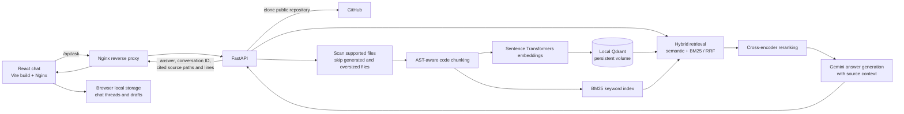

# Architecture

## Request and indexing flow

## Components

- **Frontend:** React and TypeScript provide the repository input, chat threads,
  follow-up questions, markdown answers, and linked source locations. Nginx
  serves the static build and proxies `/api/*` to FastAPI on the private
  Compose network.
- **Ingestion:** FastAPI validates the GitHub URL, shallow-clones the public
  repository, scans supported files, skips ignored directories and files over
  the scanner's size limit, and chunks source documents.
- **Retrieval:** Sentence Transformers embeddings are stored in local Qdrant.
  BM25 keyword search and semantic search are fused, then a cross-encoder
  reranks candidates before answer generation.
- **Answer generation:** Gemini receives the current question, conversation
  context, and retrieved code. The API returns source paths and line ranges;
  the frontend links those sources to the corresponding GitHub file.

## Persistence and scaling

Docker Compose persists repository clones and Qdrant files in `gitcontext_data`
and the model download cache in `model_cache`. Browser chat threads are stored
in that browser's local storage. Conversation context and the in-memory BM25
and repository-context caches are process-local and are lost when the API
restarts.

Run one backend process per local Qdrant data directory. This setup is intended
for a single-instance deployment; horizontal API replicas need shared
conversation storage and a server-mode or managed vector database, plus
coordination for repository indexing.

## Trust boundaries

- The API accepts public GitHub repository URLs only.
- Repository contents are untrusted input to the language model; prompts
  instruct the model not to follow instructions in source files.
- The Gemini API key stays in the backend environment and is not included in
  the frontend build.
- Use TLS at the public ingress and provide explicit frontend origins in
  `CORS_ORIGINS` when hosting the frontend separately.
