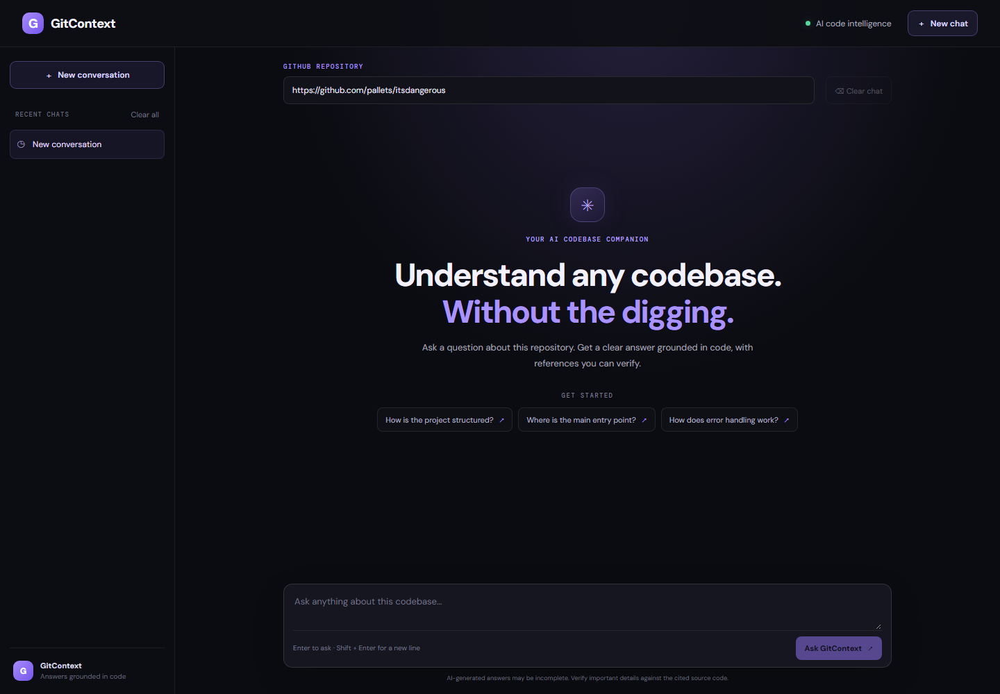
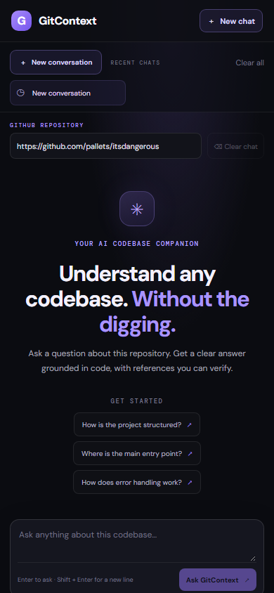

# Demo

## Run the application

1. Copy `.env.example` to `.env` and add a valid Gemini API key.
2. Run `docker compose up --build`.
3. Open `http://localhost:8080`.
4. Enter a public GitHub repository and ask a question such as
   **“Where is the main entry point?”**
5. Ask a contextual follow-up such as **“What calls it?”** and open a source
   citation to verify the answer.
6. Use **New chat** to start a separate conversation, or **Clear chat** to
   clear the current thread.

The first request clones and indexes the repository and may take several
minutes while the model weights are downloaded. Later questions reuse the
running process's repository index. Restarting the containers keeps the
downloaded repository and Qdrant files, but process-local conversation and
keyword-index state is rebuilt.

## Screenshots

Desktop and mobile interface screenshots:





## API demo

The local API is proxied through the frontend origin:

```powershell
curl.exe -X POST http://localhost:8080/api/ask `
  -H "Content-Type: application/json" `
  -d '{"question":"Where is the main entry point?","repo_url":"https://github.com/pallets/itsdangerous","conversation_id":"demo-session"}'
```

API documentation is available at `http://localhost:8080/api/docs`.
